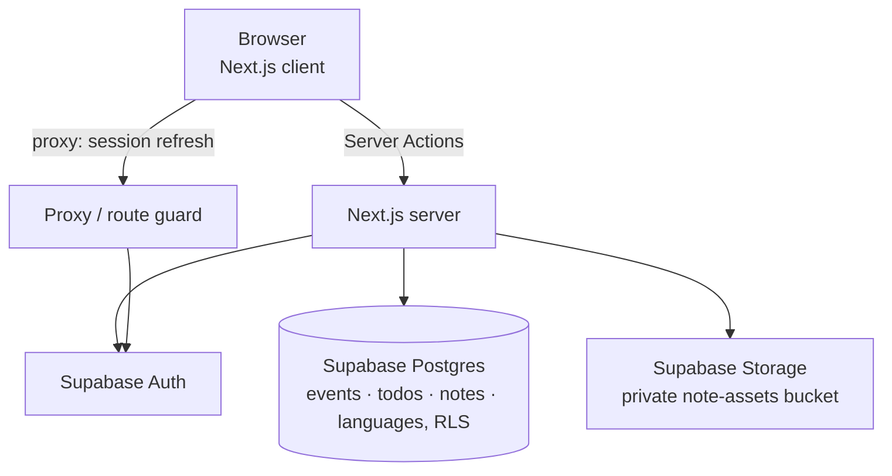
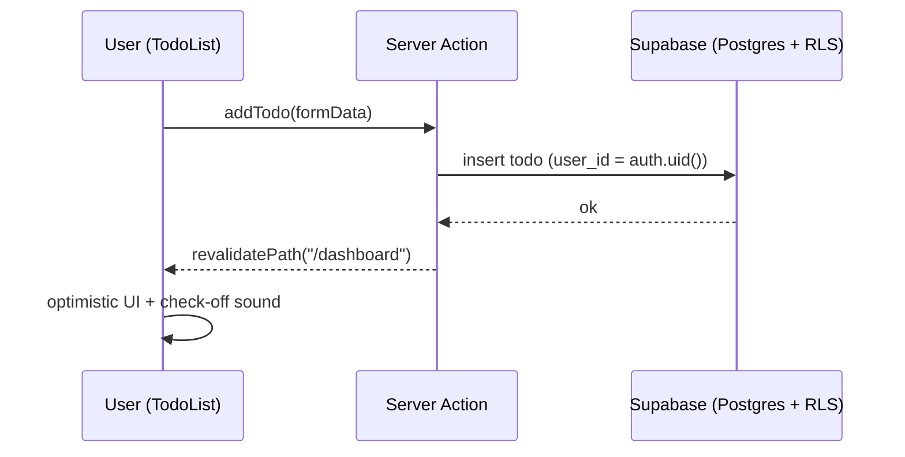

# Luce — A Minimalist Personal Command Center

_luce_ (Italian) — **light.** A calm web app that acts as your personal **command center**: a calendar for the things that matter, to-do lists with a satisfying check-off sound, a hierarchical notes & knowledge workspace, a spaced-repetition **language-learning** studio, and room for an interactive 3D centerpiece. Everything important, in one quiet place — in English or Polish, light or dark.

---

## Visuals

> The gallery below will be filled with screenshots and a short demo GIF once they are captured.
>
> Suggested shots:
> 1. Landing / hero with the glowing centerpiece
> 2. Login & register screens
> 3. Dashboard with the calendar panel
> 4. To-do list with a checked-off task
> 5. Notes workspace: folder tree + a note with a table and checklist
> 6. Languages: a review session (flashcard) and the vocabulary list

---

## Why this project exists

Notes, reminders, to-dos and study materials usually end up scattered across sticky notes, phone apps and half-forgotten documents. Luce brings them together into a single, deliberately minimal space that is calm to look at and quick to use.

The design principles are simple:

- **Calm by design.** A dark-first palette tuned for low-light focus, with optional light and system themes — no visual noise.
- **Minimal surface, maximum whitespace.** Only what matters is on screen.
- **Small moments of delight.** A soft sound when you check something off; a gentle glow in the background.
- **Yours only.** Data is scoped per user with row-level security, so you see only your own calendar, tasks, notes and vocabulary.

---

## Core features

| Feature | Description |
|---------|-------------|
| Authentication | Email + password sign-up and login via Supabase, with a session-refreshing proxy that guards every private route. |
| Dashboard | A single command center with a centered, full-screen menu-overlay navigation and an ambient light backdrop. |
| Calendar | A Monday-first monthly calendar; click any day to add or remove events and notes. |
| To-do lists | Add, complete and delete tasks with optimistic UI and a live "remaining" count. |
| Notes & knowledge | Nested folders and a block-style editor (BlockNote): headings, lists, checklists, quotes, dividers, code blocks, tables and **image uploads**. Autosave, pinning, breadcrumbs, move/rename/delete and full-text-ish search over titles and content. |
| Languages studio | Per-language **profiles** (CEFR level, daily goal), durable **vocabulary**, hierarchical semantic **topics**, **scheduled review** powered by the FSRS spaced-repetition algorithm, a non-scheduling **practice** mode, and **links from notes** to language profiles and topics. |
| Internationalization | Full English and Polish interface, selectable in-app and remembered via a cookie. |
| Theme | Dark by default, with light and system (OS-driven) options, remembered in local storage and applied before first paint to avoid flashes. |
| Check-off sound | A confirmation sound plays when a task is checked, with a synthesized fallback until a custom audio file is added. |
| Graceful setup | If Supabase keys are missing, the app shows a friendly setup notice instead of crashing. |
| 3D-ready | A placeholder centerpiece is wired in, ready to be swapped for an interactive Spline scene. |

---

## Tech stack

| Layer | Technology |
|-------|------------|
| Framework | Next.js 16 (App Router, Turbopack) |
| Language | TypeScript (strict) |
| Runtime | React 19 |
| UI / styling | Tailwind CSS v4 (theme tokens in `src/app/globals.css`, no config file) |
| Auth + database | Supabase (`@supabase/ssr`, `@supabase/supabase-js`) with row-level security |
| File storage | Supabase Storage (private `note-assets` bucket for note images) |
| Notes editor | BlockNote (`@blocknote/core`, `@blocknote/react`, `@blocknote/mantine`) |
| Spaced repetition | FSRS via `ts-fsrs`, isolated behind a single scheduler module |
| i18n | Hand-rolled EN/PL dictionaries with cookie persistence (no external library) |
| Sound | Web Audio API (with an audio-file fallback path) |
| Tests | Vitest (unit tests for pure logic) |
| 3D (planned) | Spline (`@splinetool/react-spline`) |

---

## Architecture

### High-level view



### Request flow (adding a task)



The app follows the **Next.js App Router** structure:

- `src/app/` — routes: landing (`page.tsx`), `login/`, `register/`, and the protected `dashboard/`, `notes/` and `languages/`.
- `src/app/auth/actions.ts` — server actions for login, register and sign-out.
- `src/app/dashboard/actions.ts` — server actions for events and todos.
- `src/app/notes/` — notes routes (`/notes`, `/notes/[id]`), server actions and the `api/notes/[id]` beacon endpoint used to flush autosaves on tab close.
- `src/app/languages/` — the languages studio: hub (`/languages`), per-profile routes (`[profileId]/`) for vocabulary, topics, review, practice and linked notes, plus their server actions.
- `src/app/locale-actions.ts` — server action that persists the interface locale in a cookie.
- `src/components/` — UI building blocks (`Calendar`, `TodoList`, `MenuOverlay`, `AuthForm`, `BlobPlaceholder`, ...) plus `components/notes/`, `components/languages/`, `components/i18n/` and `components/theme/`.
- `src/lib/supabase/` — browser and server Supabase clients, the session-refresh helper, and the graceful "is configured?" check.
- `src/lib/notes/` — framework-free, testable helpers: tree building, cycle/descendant detection, breadcrumbs, the editor-JSON → plain-text extractor used for search, and image-asset path helpers.
- `src/lib/languages/` — language catalog/topics helpers, note-link helpers, and the `srs/` subpackage (FSRS scheduler, review queue, practice planner, session summaries), all isolated and unit-tested.
- `src/lib/i18n/` — EN/PL dictionaries, locale normalization, server/client translation helpers.
- `src/proxy.ts` — refreshes the session on every request and redirects unauthenticated users away from `/dashboard`, `/notes` and `/languages`.
- `supabase/schema.sql` — full database schema (canonical, re-runnable snapshot); `supabase/migrations/` holds incremental migrations.

### Notes: data & save flow

- Reads happen in server components; structural changes (create / rename / move / delete / pin) are server actions that `revalidatePath` the notes tree.
- Note **body** is a BlockNote JSONB document, autosaved with a debounce (~700 ms). Content saves intentionally skip revalidation to avoid re-fetching the tree on every keystroke; pending edits are flushed when switching notes (unmount) and on tab close (`navigator.sendBeacon`).
- A derived `search_text` column mirrors title + content as plain text, so search is a simple, index-friendly `ILIKE` that can later grow into Postgres full-text search.
- Note **images** are uploaded to a private Supabase Storage bucket (`note-assets`) under a `userId/noteId/<uuid>.<ext>` path; a storage policy proves ownership of the target note, and rendering uses short-lived signed URLs.

### Languages: spaced repetition

- Vocabulary content lives in `vocabulary_items`; scheduling state is kept **separately** in `vocabulary_srs_states` (one row per item, mirroring the FSRS card shape).
- FSRS transitions are computed server-side; the client only sends session / item / rating / response time. Nothing outside `src/lib/languages/srs/scheduler.ts` imports `ts-fsrs`.
- Every scheduler write goes through the atomic `record_review` Postgres function: it verifies ownership, enforces optimistic concurrency (`row_version`), updates the state and appends an immutable `review_events` row in one transaction.
- **Practice** mode reuses the same machinery but hard-codes `affected_schedule = false`, so extra study records history **without ever changing** the FSRS schedule.

---

## Data model

Every table is protected by row-level security so each user can only read and write their own rows (`auth.uid() = user_id`). Ownership is enforced in the database — triggers reject cross-user folders/topics, self-parenting and circular hierarchies; cascades keep rows from being orphaned.

**Core**

| Table | Purpose |
|-------|---------|
| `events` | Calendar entries, one or more per day. |
| `todos` | To-do items with a completion flag. |
| `note_folders` | Recursively nested notes folders (`parent_id` self-reference; `null` = root). |
| `notes` | Notes; `content` is the BlockNote JSONB document, `search_text` its plain-text projection, plus `is_pinned`/`position`. |

**Languages**

| Table | Purpose |
|-------|---------|
| `language_profiles` | One active profile per studied BCP 47 language code and user; CEFR levels, daily goal; soft-archived (`archived_at`) to retain history. |
| `language_topics` | Recursively nested semantic topics scoped to a profile. |
| `vocabulary_items` | Durable vocabulary content (term, translation, definition, examples, etc.); no scheduling state. |
| `vocabulary_topics` | Many-to-many vocabulary ↔ topic associations. |
| `vocabulary_srs_states` | Per-item FSRS scheduler state (due, stability, difficulty, reps, lapses, `row_version`). |
| `study_sessions` | Shared Review + Practice sessions (`session_kind`, `configuration`, `status`). |
| `review_events` | Immutable review history (rating, timing, before/after state). |
| `language_note_links` / `language_note_topics` | Link existing notes to a language profile and, optionally, to topics. |

A private Storage bucket, **`note-assets`**, holds note images (10 MB limit; JPEG/PNG/WebP/GIF only).

The full schema — tables, indexes, triggers, the `record_review` RPC and RLS policies — lives in [`supabase/schema.sql`](supabase/schema.sql).

---

## Getting started

### Prerequisites

- Node.js 20+ (tested on Node 22)
- npm
- A free [Supabase](https://supabase.com) project

### 1. Install dependencies

```bash
npm install
```

> npm note: this repo relies on npm auto-installing peer deps (e.g. `@mantine/core`
> for `@blocknote/mantine`). Do **not** install with `--legacy-peer-deps` — it prunes
> those peers and breaks the build.

### 2. Configure environment

Copy the example file and fill in the keys from **Supabase → Project Settings → API**:

```bash
cp .env.example .env.local
```

```bash
NEXT_PUBLIC_SUPABASE_URL=...
NEXT_PUBLIC_SUPABASE_ANON_KEY=...
```

### 3. Create the database

In the Supabase dashboard, open the **SQL Editor**, paste the contents of
[`supabase/schema.sql`](supabase/schema.sql) and run it. This creates every table
(events, todos, notes, and the full languages model) together with their RLS
policies, triggers, indexes and the `record_review` function.

> **Already have an older Luce database?** Apply only the missing incremental
> migrations from [`supabase/migrations/`](supabase/migrations), in order:
>
> - `0001_notes.sql` — notes folders + notes
> - `0002_language_profiles.sql` — language profiles
> - `0003_language_vocabulary_topics.sql` — vocabulary + topics
> - `0004_language_review_srs.sql` — FSRS scheduling, sessions, review history
> - `0005_language_notes.sql` — note ↔ language links
> - `0006_note_assets_storage.sql` — private `note-assets` Storage bucket for images

There is no Supabase CLI configured; apply SQL manually via the dashboard.

### 4. Run the app

```bash
npm run dev
```

Open [http://localhost:3000](http://localhost:3000), create an account and you're in.

### Useful scripts

```bash
npm run dev     # start the dev server (http://localhost:3000)
npm run build   # production build (Turbopack)
npm run start   # run the production build
npm run lint    # ESLint (flat config: next core-web-vitals + typescript)
npm run test    # Vitest unit tests (pure logic)
npx tsc --noEmit  # TypeScript type check (no npm script)
```

> If `tsc` or `build` reports syntax errors inside `.next/dev/types/`, that is a
> stale Next.js dev cache, not a source error. Delete `.next` and re-run.

---

## Project structure

```
luce/
├── src/
│   ├── app/
│   │   ├── page.tsx            # landing / hero
│   │   ├── login/              # login screen
│   │   ├── register/           # register screen
│   │   ├── auth/actions.ts     # login / register / sign-out actions
│   │   ├── locale-actions.ts   # persist interface locale (cookie)
│   │   ├── dashboard/          # protected command center (calendar + to-dos)
│   │   ├── notes/              # protected notes workspace (+ api/notes/[id])
│   │   └── languages/          # protected languages studio
│   │       ├── page.tsx        # language hub
│   │       └── [profileId]/    # vocabulary · topics · review · practice · notes
│   ├── components/
│   │   ├── notes/              # sidebar, tree, editor, dialogs, toasts, ...
│   │   ├── languages/          # hub, dialogs, review/practice session runners, ...
│   │   ├── i18n/               # provider + locale selector
│   │   ├── theme/              # provider + pre-paint theme script
│   │   └── ...                 # Calendar, TodoList, MenuOverlay, Logo, ...
│   ├── lib/
│   │   ├── supabase/           # browser + server clients, session + config helpers
│   │   ├── notes/              # tree/search/asset helpers + shared types
│   │   ├── languages/          # catalog/topics/note-link helpers + srs/ subpackage
│   │   ├── i18n/               # EN/PL dictionaries + translation helpers
│   │   ├── navigation/         # menu-section logic
│   │   ├── types.ts            # shared types
│   │   └── useCheckSound.ts    # check-off sound hook
│   └── proxy.ts                # session refresh + route guard
├── supabase/
│   ├── schema.sql              # full schema (tables, triggers, RLS, record_review)
│   └── migrations/             # incremental migrations (0001 … 0006)
├── public/sounds/              # drop check.mp3 here
└── README.md
```

---

## Roadmap

The project is built in stages. Everything below through the Languages studio is implemented.

- [x] **Stage 0 — Setup.** Next.js + TypeScript + Tailwind, git repo, README.
- [x] **Stage 1 — UI foundation.** Minimalist, dark-first design system and hero.
- [x] **Stage 2 — Auth.** Supabase login/register, protected routes, graceful setup notice.
- [x] **Stage 3 — Dashboard.** Menu-overlay navigation and ambient light backdrop.
- [x] **Stage 4 — Calendar.** DB schema with RLS, monthly calendar with per-day events.
- [x] **Stage 5 — To-do + sound.** Optimistic to-do lists with a check-off sound.
- [x] **Stage 6 — Notes & knowledge.** Nested folders, a BlockNote block editor (headings, lists, checklists, quotes, dividers, code, tables, images), autosave, pinning, breadcrumbs, move/rename/delete and search — all per-user with RLS.
- [x] **Languages studio.** Profiles, vocabulary, semantic topics, FSRS spaced-repetition review, a non-scheduling practice mode, and note ↔ language links.
- [x] **Internationalization.** Full English and Polish interface with cookie-persisted locale.
- [x] **Theme system.** Dark / light / system appearance, remembered and applied before first paint.
- [ ] **Spline 3D.** Replace the placeholder centerpiece with an interactive Spline scene.

### Future improvements

- Swap the `BlobPlaceholder` for a real Spline scene (`@splinetool/react-spline`).
- Add a custom `public/sounds/check.mp3` in place of the synthesized tick.
- Notes: templates, richer full-text search, and deeper links between notes, tasks and calendar events.
- Languages: review statistics / progress dashboards and safe cleanup of orphaned note images.
- Recurring events and reminders.
- Drag-to-reorder for to-do items.
- CI for automated linting, type checks, tests and builds.

---

## License

This project is released under the MIT License. See [LICENSE](LICENSE) for details.

---

## Acknowledgments

Built by **BobbiJohnson03**. Visual inspiration from [junhyungpark.com](https://junhyungpark.com/).
